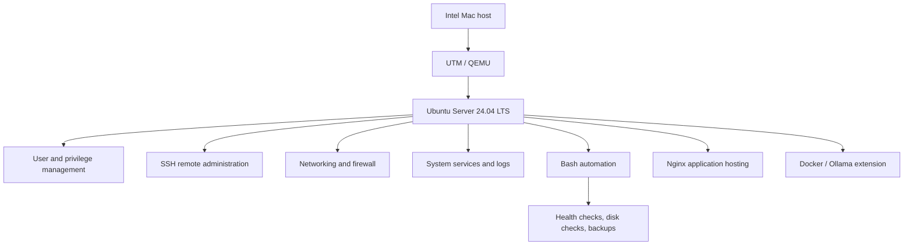

# Linux Server Administration & Automation

A hands-on Linux infrastructure project focused on server administration, security hardening, networking, Bash automation, monitoring, application hosting, and operational troubleshooting.

> **Project status:** In progress  
> **Environment:** Ubuntu Server 24.04 LTS (x86_64) running in UTM on an Intel Mac  
> **Purpose:** Build practical Linux systems administration skills and demonstrate them through reproducible implementation, verification, and documentation.

---

## Table of contents

- [Project overview](#project-overview)
- [Why this project exists](#why-this-project-exists)
- [Lab environment](#lab-environment)
- [Architecture](#architecture)
- [Project scope](#project-scope)
- [Repository structure](#repository-structure)
- [How the project will be developed](#how-the-project-will-be-developed)
- [Evidence and verification](#evidence-and-verification)
- [Security considerations](#security-considerations)
- [Current progress](#current-progress)
- [Learning outcomes](#learning-outcomes)

## Project overview

This project simulates the administration of an internal Linux server that supports business applications. The work is organised around practical operational responsibilities:

- Provisioning and understanding a Linux server.
- Managing users, groups, permissions, and privileged access.
- Configuring secure remote administration with SSH.
- Understanding Linux networking and troubleshooting connectivity.
- Managing storage, processes, packages, and system services.
- Investigating authentication events and system logs.
- Automating routine administration with Bash.
- Monitoring system health and disk utilisation.
- Implementing and verifying scheduled backups.
- Hosting an application using Nginx.
- Extending the environment with a containerised Ollama service.

The project is deliberately incremental. Each capability will be implemented, tested, and documented before it is marked complete.

## Why this project exists

Linux is a core building block of cloud infrastructure, containers, Kubernetes platforms, CI/CD runners, and production services.

The objective is to develop the operational understanding required to work confidently with Linux systems—not simply to memorise commands.

This repository will provide evidence of both the learning process and the resulting implementation through configuration files, scripts, command output, screenshots, and troubleshooting reports.

## Lab environment

| Component | Configuration |
|---|---|
| Host machine | Intel-based Mac |
| Virtualisation | UTM using QEMU emulation |
| Guest operating system | Ubuntu Server 24.04 LTS |
| Architecture | x86_64 / AMD64 |
| Virtual CPUs | 2 cores |
| Memory | 4 GB (adjustable to host capacity) |
| Virtual disk | 30 GB |
| Network | Shared / NAT |
| Server hostname | `linux-server-lab` |
| Administrative user | `labadmin` |
| Remote administration | OpenSSH Server |

The virtual machine is isolated from the host's physical storage. Installation and disk operations must be performed against the VM's virtual disk only.

## Architecture

The initial lab is a single Ubuntu Server virtual machine. Services and automation will be added as the project progresses.



## Project scope

### 1. Linux fundamentals and system administration

- Linux architecture and distribution fundamentals.
- Filesystem hierarchy and directory navigation.
- File and directory creation, editing, copying, moving, and deletion.
- Package management with APT.
- Process inspection and management.
- System resource inspection.

### 2. User and permission management

- Create and manage local users and groups.
- Understand ownership and permission modes.
- Apply least-privilege access.
- Configure and review sudo access.
- Verify access boundaries.

### 3. SSH and server security

- Configure and inspect the OpenSSH service.
- Understand SSH authentication and key-based access.
- Review SSH authentication events.
- Apply appropriate remote-access restrictions.
- Configure and verify UFW firewall rules.
- Document security decisions and validation steps.

### 4. Linux networking

- Inspect interfaces and IP configuration.
- Understand routes, gateways, DNS, and ports.
- Test network connectivity.
- Inspect listening sockets.
- Troubleshoot name-resolution and connectivity problems.

### 5. Storage, processes, and services

- Inspect block devices, filesystems, and mounts.
- Investigate disk usage and capacity.
- Inspect CPU, memory, and running processes.
- Manage services with `systemctl`.
- Investigate service and system events with `journalctl`.

### 6. Bash automation

Planned scripts:

| Script | Responsibility |
|---|---|
| `server-health-check.sh` | Report key system health information |
| `disk-monitor.sh` | Check filesystem utilisation and report threshold breaches |
| `backup.sh` | Create and verify backups of selected data |

Scripts will include input validation, useful exit codes, logging, and safe handling of errors where appropriate.

### 7. Monitoring, logging, and backups

- Review authentication and system logs.
- Identify relevant SSH login and authentication events.
- Schedule recurring tasks with cron or systemd timers.
- Implement backup retention and verification.
- Test restoration, not just backup creation.
- Document operational checks.

### 8. Application hosting

- Install and configure Nginx.
- Host a basic internal web page or application.
- Inspect service status and logs.
- Validate local and remote connectivity.
- Document configuration and troubleshooting.

### 9. Containerised application extension

Run Ollama in a Docker container as an internal chatbot workload.

This extension will explore:

- Docker installation and service management on Linux.
- Container lifecycle and logs.
- Persistent model storage.
- Resource consumption and disk capacity.
- Service availability and troubleshooting.

The chatbot extension will be documented separately from the core Linux administration objectives. Features such as a web UI, API integration, or retrieval-augmented generation will only be added if they are implemented.

## Repository structure

```text
linux-server-administration/
├── README.md
├── docs/
│   ├── architecture/
│   ├── incident-reports/
│   ├── 01-linux-fundamentals/
│   ├── 02-user-management/
│   ├── 03-ssh-and-security/
│   ├── 04-networking/
│   ├── 05-storage-processes-services/
│   ├── 06-automation/
│   ├── 07-monitoring-logging-backups/
│   ├── 08-application-hosting/
│   └── 09-containerised-workloads/
├── scripts/
├── configs/
│   └── nginx/
└── screenshots/
    ├── phase-01/
    └── ...
```

## How the project will be developed

Each module follows the same engineering workflow:

1. **Understand:** Learn the Linux concept and the operational problem it addresses.
2. **Implement:** Configure the server or write the automation.
3. **Verify:** Run commands and tests to confirm the expected behaviour.
4. **Troubleshoot:** Investigate failures and record the root cause.
5. **Document:** Explain the implementation, decisions, commands, and results.
6. **Commit:** Save the working changes with a clear Git commit message.

A feature is not considered complete merely because a command was executed. It must have a documented verification step.

## Evidence and verification

Evidence will be stored in `screenshots/` and relevant documentation folders.

Examples include:

- Operating system and hostname information.
- User and permission configuration.
- SSH service status and authentication log investigation.
- Firewall rules and listening ports.
- Disk, memory, and process information.
- Successful script execution and error handling.
- Backup creation and restore verification.
- Nginx service status and HTTP response.
- Container status and Ollama service logs.

Screenshots must not expose passwords, private keys, tokens, or other secrets. Where possible, command output and reproducible test instructions will accompany screenshots.

## Security considerations

- Never commit passwords, private SSH keys, API tokens, or other credentials.
- Use placeholders for sensitive values in example configuration.
- Apply changes incrementally and retain a recovery path.
- Verify firewall and SSH changes before ending an existing administrative session.
- Use a disposable virtual machine snapshot before higher-risk experiments.
- Do not expose the lab server to the public internet as part of the basic project.

## Current progress

The repository starts as a project scaffold. Items below will be checked only after implementation and verification.

- [ ] Create the Ubuntu Server virtual machine.
- [ ] Complete the initial Ubuntu Server installation.
- [ ] Verify hostname, OS version, CPU, memory, and storage.
- [ ] Verify OpenSSH service availability.
- [ ] Complete Linux filesystem and command-line exercises.
- [ ] Implement user, group, and permission management.
- [ ] Configure and verify SSH access.
- [ ] Configure and verify firewall rules.
- [ ] Complete networking exercises.
- [ ] Implement Bash health and disk monitoring scripts.
- [ ] Implement scheduled backups and test restoration.
- [ ] Configure Nginx application hosting.
- [ ] Complete troubleshooting incident reports.
- [ ] Implement the containerised Ollama extension.

## Learning outcomes

On completion, this project should demonstrate practical ability to:

- Administer an Ubuntu Linux server.
- Manage users, permissions, services, and system resources.
- Secure and investigate remote access.
- Diagnose common networking and service issues.
- Write and maintain Bash automation.
- Implement and verify operational backups.
- Host and troubleshoot a Linux-based application.
- Document infrastructure changes and operational incidents.

---

**Note:** This is a personal learning project. The repository will distinguish between planned, implemented, and tested capabilities so that its documentation accurately reflects the state of the lab.
